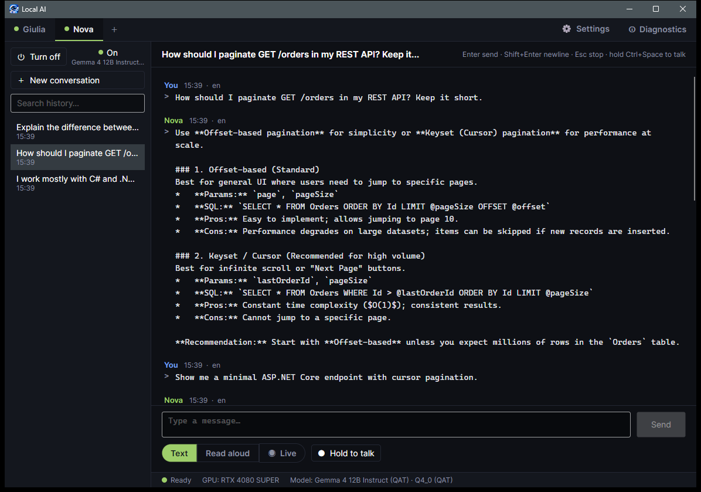
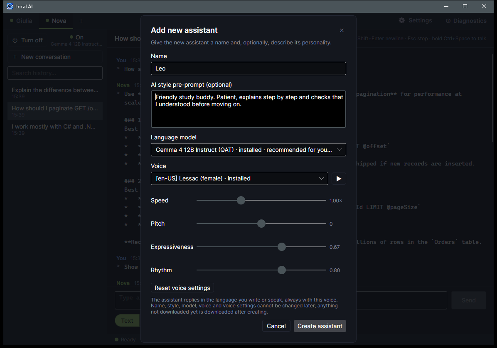
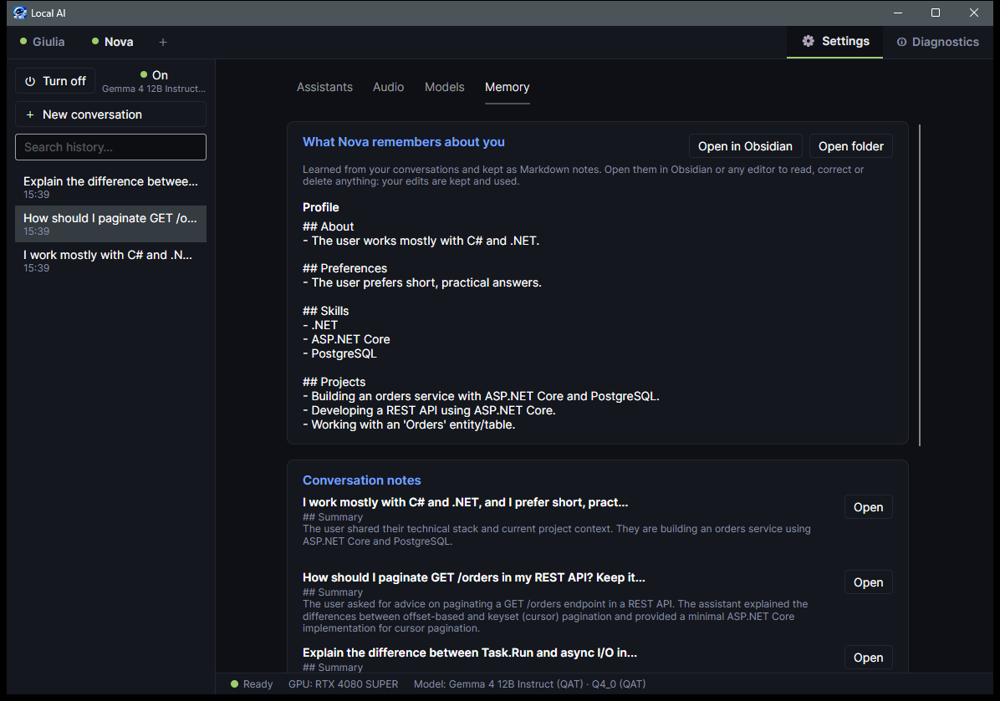
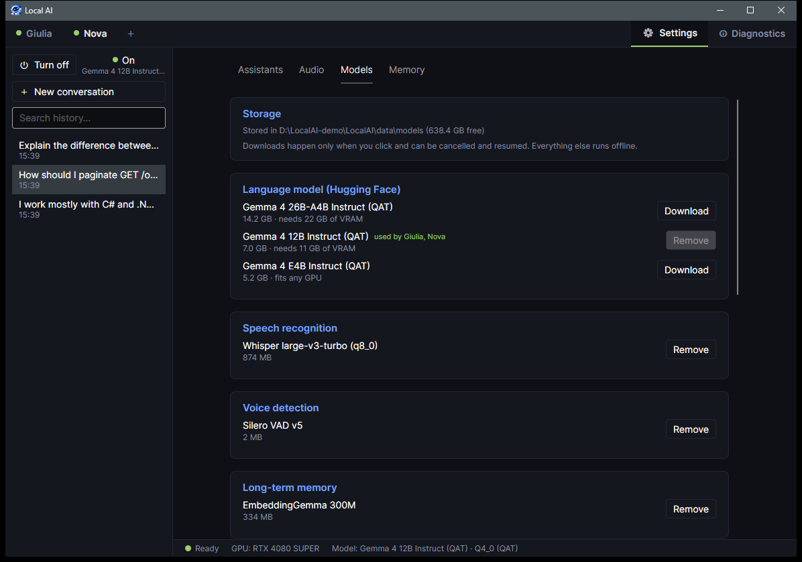
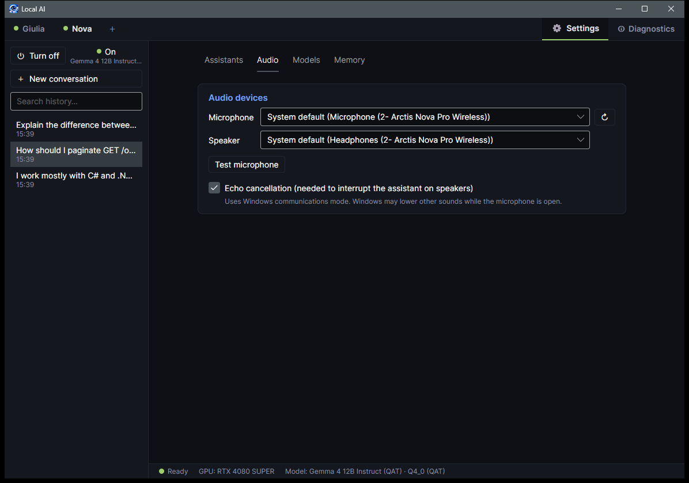

<h1 align="center">Local AI</h1>

<p align="center">
  
</p>

<p align="center">
  <b>Personal AI assistants that run entirely on your Windows PC.</b><br>
  Chat or talk out loud. Conversations, voice and memories never leave your computer.
</p>

<p align="center">
  
  
  
  
</p>

<p align="center">
  
</p>

- **Your own assistants:** each with a name, personality, language model, voice and voice settings (speed, pitch,
  expressiveness, rhythm), chosen when you create it, plus its own conversations and memories. The voice settings
  start at the values the voice was made for, and their ranges follow the chosen voice.
- **One click away:** one tab per assistant at the top of the window, **＋** to add a new one. The dot on a tab shows
  its AI: green on, yellow loading (its model or its voice) or saving its memory before turning off, red off. Switching tabs never loads a model: the
  **Turn on / Turn off** button above the conversations does (one model runs at a time; assistants with the same model
  share it). While the AI is off, Send is disabled.
- **Speaks your language:** every assistant replies in the language you write or speak, always with its own voice.
  Voices are listed with their language, e.g. `[pt-BR] Faber (male)`.
- **Text or voice:** three reply modes, from silent chat to a hands-free spoken conversation (see below).
- **Always at hand:** it runs in the notification area. Give each assistant a global shortcut to start and stop a
  voice conversation from any application; the tray icon blinks while it listens.
- **A memory you can read:** each assistant keeps what it learns as Markdown notes, ready to open in Obsidian (see below).
- **Fully offline:** llama.cpp (Gemma 4, Qwen3.5 or gpt-oss), Whisper, Piper and SQLite on your GPU. The Internet is
  used only to download models.
- **Models for your GPU:** from Qwen3.5 4B for small cards to Qwen3.5 35B-A3B for 32 GB ones. When you create an
  assistant, the models that fit your GPU come first, with one recommended; larger ones still run, split between GPU
  and CPU, but slower.
- **Portable:** everything stays in the app folder. Copy it to install, delete it to remove every trace.

<table>
  <tr>
    <td width="50%"></td>
    <td width="50%"></td>
  </tr>
  <tr>
    <td align="center">Add an assistant: personality, model, voice and voice settings</td>
    <td align="center">What it remembers about you, as Markdown notes</td>
  </tr>
  <tr>
    <td></td>
    <td></td>
  </tr>
  <tr>
    <td align="center">Models downloaded and managed in the app</td>
    <td align="center">Audio devices: the system default, or one you pick</td>
  </tr>
</table>

## Three ways to talk

Pick a mode with the **Text · Read aloud · Live** switch under the message box. The app remembers your choice.
In **Settings › Assistants › Ways to talk** you can turn Read aloud and Live off; Text is always available.

<table>
  <tr>
    <th width="33%">⌨️ Text</th>
    <th width="33%">🔊 Read aloud</th>
    <th width="33%">🎙️ Live</th>
  </tr>
  <tr valign="top">
    <td>
      <b>Quiet chat.</b> You type and the reply appears as streaming text. Nothing is played and the microphone
      stays closed.
    </td>
    <td>
      <b>Chat with a voice.</b> You type and the reply appears as text while the assistant's voice reads it to you.
      The microphone stays closed.
    </td>
    <td>
      <b>A spoken conversation.</b> The microphone stays open: just talk. The assistant answers aloud and then
      listens again. Speak over it to interrupt it at any time. You can still type, and typed messages are answered
      aloud too.
    </td>
  </tr>
  <tr valign="top">
    <td><i>Best for:</i> work, shared rooms, long answers.</td>
    <td><i>Best for:</i> listening while you do something else.</td>
    <td><i>Best for:</i> hands-free, back-and-forth conversation.</td>
  </tr>
</table>

- **Push-to-talk** works in Text and Read aloud modes. Hold **● Hold to talk** (or **Ctrl+Space**) while you speak.
  The assistant replies aloud.
- **Live from anywhere:** an assistant's global shortcut switches Live mode on and off from any application, and so
  does **Live mode** in the tray icon's menu. The tray icon blinks while the assistant listens. Shortcuts are
  unavailable while Live is turned off.
- **Esc** stops the current reply in every mode, and so does **Stop**, which takes the place of Send while a reply runs.
  Switching from Live to another mode closes the microphone but lets the reply being spoken finish; turning Live off
  with the shortcut stops it. Live mode needs a microphone and the speech recognition model.

### A natural conversation

Live mode takes turns the way people do. You can change each of these in **Settings › Assistants › Live conversation**:

- **Pausing mid-sentence:** if what you said sounds unfinished ("I went to the store and…"), the assistant waits a
  little longer before answering. If you go on talking before the reply starts, what you said before and after the
  pause becomes one message.
- **Reactions while you talk:** in the pauses of a longer message, the assistant sometimes says *"mm-hmm"* or
  *"I see"*, in your language and in the assistant's voice. Choose **Subtle** (the default), **Frequent** or **Off**.
- **Filling a slow reply:** when the reply takes more than 1.5 seconds to start, the assistant says *"hmm, let me
  see..."* first. Choose the delay or **Never**.

The phrases for each language are in `languages.json`, next to the executable.

## Ask about what's on your screen

**Read selection** lets you point the assistant at anything you are reading, in any application: an error in Visual
Studio, a function in VS Code or Notepad++, a log line in Unity, a paragraph in your browser.

1. Turn Live mode on (switch, tray menu or the assistant's shortcut).
2. Start talking, and select the text with the mouse while you speak: drag over it, or double- or triple-click.
3. When you stop talking, what you said and the selected text are sent together, so you can just ask
   *"why does this fail?"*, *"what does this function do?"* or *"translate this"*.

The chat shows the selected text as a quote above your message, and it stays in the conversation, so follow-up
questions ("and how do I fix it?") still see it. Only the latest selection is sent, once, with your next message
(spoken or typed); a hint under the message box shows when one is waiting. Very long selections are cut at 8,000
characters.

Turn it on in **Settings › Assistants › Ways to talk**, under Live. It is off by default.

How the text is read:

- First silently, through Windows UI Automation: browsers, Word, Notepad and most standard Windows apps.
- Applications that do not share their text that way (Notepad++, Unity, VS Code, parts of Visual Studio) get a
  **Ctrl+C**, and your clipboard is put back right after. Your copied text is restored exactly; if the clipboard holds
  something else (files, an image), the copy is skipped so you never lose it. Formatting of copied text is not
  restored, only the text.
- To stay harmless, no Ctrl+C is sent in terminals (it would stop the running program), while a key or mouse button is
  held, or when you dragged a scroll bar, title bar, tab, button or similar control.
- Password fields and Local AI's own window are ignored. Applications running as administrator cannot be read unless
  Local AI runs as administrator too.

## A memory you can read and edit

Each assistant learns from every conversation and keeps it as plain Markdown notes, one folder per assistant:

```
local-ai/
  nova/
    nova-identity.md                                 who the assistant is
    nova-profile.md                                  what it knows about you
    conversations/2026-10-22-orders-api-pagination.md  one note per conversation
```

- **Identity:** who the assistant is: what it does, the personality and style you gave it, and its model, voice,
  voice settings and shortcut as note properties. Written when the assistant is created and kept up to date; it is
  what the assistant reads to know who it is, so editing it changes how the assistant acts.
- **Profile:** about you, preferences, skills, projects and routine, merged and kept up to date from your
  conversations.
- **Conversation notes:** summary, decisions, open items and the facts learned, with links you can follow in
  Obsidian.
- **Personal RAG:** before each reply the assistant reads its profile of you and the passages of its notes most
  related to what you ask (by meaning and by words), and can name the note it used. It searches the notes of your
  100 most recent conversations; a small database icon next to a conversation in the list lights up when its note is
  in the search.
- **Your edits win:** open the notes in [Obsidian](https://obsidian.md/) or any editor to correct, add or delete
  anything. A part you changed is never overwritten, lines you add to the profile are kept, and text you write
  outside the generated part is never touched. Notes you delete come back the next time the conversation is
  processed; delete the conversation in the app to remove its note for good.
- **Never in your way:** notes are written in the background, a few minutes after a conversation goes quiet or when
  you open another one, and only while the assistant is idle. **Turn off** finishes the work left for that
  assistant first (its tab turns yellow, "Saving memory"), then unloads its model; **Turn on** meanwhile stops it and
  the rest waits for later. **Exit** in the tray does the same for the assistants whose AI is on before closing
  (choose Exit again to close right away). The moment you type or speak, that work stops and
  waits. While it runs, the status bar at the bottom of the window turns yellow and names each step (summarizing,
  merging the profile, embedding, saving), and a dot on the tray icon turns yellow (in Live mode the tray icon blinks
  red instead: the assistant is listening). The steps of a reply show there in blue (searching the notes, building
  the prompt, generating, speaking, saving). To watch them, turn on **slow motion** in Diagnostics, and press
  **Process memory now** to write the current conversation's notes right away.
- **Where:** in the app folder by default. In **Settings › Memory** choose your Obsidian vault and the notes move
  into its `local-ai` folder, next to your own notes. There you can also pick the language of new notes (English by
  default; the assistant reads them whatever language you talk in). **Open directory** next to each assistant in
  **Settings › Assistants** opens its folder, in the vault when you chose one.

**Settings › Memory** shows what the active assistant remembers (its profile and conversation notes), with buttons to
open them in Obsidian or in their folder.

## Getting started

**Download:** get `LocalAI-win-x64.zip` from the [latest release](https://github.com/lluancarlo/LocalAI/releases/tag/latest)
(built from `master` on every push), unzip it anywhere writable and run `LocalAI\LocalAI.exe`.

**Build it yourself:** you need Windows 11, the [.NET 10 SDK](https://dotnet.microsoft.com/download), an NVIDIA GPU
(recommended) and about 9 GB of disk space for models.

```powershell
git clone https://github.com/lluancarlo/LocalAI.git
cd LocalAI
powershell -ExecutionPolicy Bypass -File scripts\publish.ps1
publish\LocalAI\LocalAI.exe
```

`publish.ps1` also writes `publish\LocalAI.zip`, the same files without `data\`.

On first launch you create your first assistant and the app downloads the models it needs.

Closing the window keeps Local AI running in the notification area. The tray icon's menu opens the window, turns
**Live mode** on and off, and **Exit** quits (first saving the memory of the assistants whose AI is on).
Set an assistant's shortcut in **Settings › Assistants**.

In **Settings › Audio**, *System default* follows whatever device Windows uses (it changes when you plug in a
headset); a device you pick yourself is used from then on, and while it is unplugged the system default stands in.

## Privacy

- **Offline:** conversations, voice and memories never leave your PC. The Internet is used only to download models.
- **One folder:** everything the app creates (database, settings, logs, temporary files, models, memory notes) is in
  `data\` next to `LocalAI.exe`. Delete the folder to remove it all. The only exception is the Obsidian vault you
  choose for the memory notes: the app then writes only inside its `local-ai` folder. If that vault is synced
  (Obsidian Sync, OneDrive, Git), the notes are synced too.
- **Per assistant:** each assistant has its own conversations and memory notes. Deleting an assistant deletes them
  too.
- **Logs** record what the app did, never what you said, typed or selected.
- **Read selection** is off by default. When on, the app reads selected text only while Live mode is on, and ignores
  password fields. In applications that need the Ctrl+C fallback, the selection briefly passes through the Windows
  clipboard: your clipboard is restored, but Windows clipboard history (Win+V) or a clipboard manager may still record
  the copied selection.
- **Outside the folder, Windows keeps its own records** of any program you run. These contain only the path of
  `LocalAI.exe` and timestamps:
  - the tray icon setting (`HKCU\Control Panel\NotifyIconSettings`);
  - microphone access history (*Settings › Privacy › Microphone*);
  - program launch data (`C:\Windows\Prefetch`).

## Built with

| Area | Technologies |
|---|---|
| Platform | C# on [.NET 10](https://dotnet.microsoft.com/), Windows 11 x64, published self-contained (no .NET install needed) |
| User interface | [Avalonia UI](https://avaloniaui.net/) (Fluent theme, Inter font), MVVM with [CommunityToolkit.Mvvm](https://github.com/CommunityToolkit/dotnet) |
| Language model | [llama.cpp](https://github.com/ggml-org/llama.cpp) `llama-server` with CUDA, running Google [Gemma 4](https://huggingface.co/google), [Qwen3.5](https://huggingface.co/Qwen) and OpenAI [gpt-oss](https://huggingface.co/openai) models (GGUF) |
| Memory | Markdown notes (Obsidian-compatible) indexed with [EmbeddingGemma 300M](https://huggingface.co/ggml-org/embeddinggemma-300M-GGUF) embeddings on llama.cpp and FTS5 full-text search in [SQLite](https://www.sqlite.org/) ([Microsoft.Data.Sqlite](https://learn.microsoft.com/dotnet/standard/data/sqlite/)) |
| Speech recognition | [Whisper.net](https://github.com/sandrohanea/whisper.net) ([whisper.cpp](https://github.com/ggml-org/whisper.cpp)) with Whisper large-v3-turbo on CUDA |
| Speech synthesis and voice detection | [sherpa-onnx](https://github.com/k2-fsa/sherpa-onnx) with [Piper](https://github.com/rhasspy/piper) voices and [Silero VAD](https://github.com/snakers4/silero-vad) |
| Audio | [NAudio](https://github.com/naudio/NAudio) (WASAPI capture and playback, echo cancellation through Windows communications mode) |
| Windows integration | Win32 global hotkeys, low-level mouse hook and UI Automation (Read selection), notification-area icon |
| Infrastructure | Microsoft.Extensions (dependency injection, configuration, options, logging), [Serilog](https://serilog.net/) file logs, [SharpZipLib](https://github.com/icsharpcode/SharpZipLib) for voice archives |
| Tests and delivery | [xUnit](https://xunit.net/), GitHub Actions (tests and a `latest` release on every push to `master`) |

Models are downloaded from inside the app, language models only from [Hugging Face](https://huggingface.co/).
Licenses of bundled components are in [THIRD-PARTY-NOTICES.md](THIRD-PARTY-NOTICES.md).

## License

No license: all rights reserved. The source code is public to read, but you may not modify, copy or distribute it.
Bundled third-party components keep their own licenses: see [THIRD-PARTY-NOTICES.md](THIRD-PARTY-NOTICES.md).
