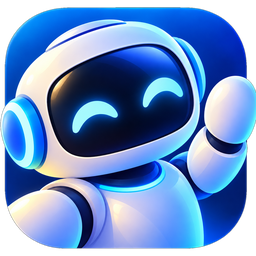
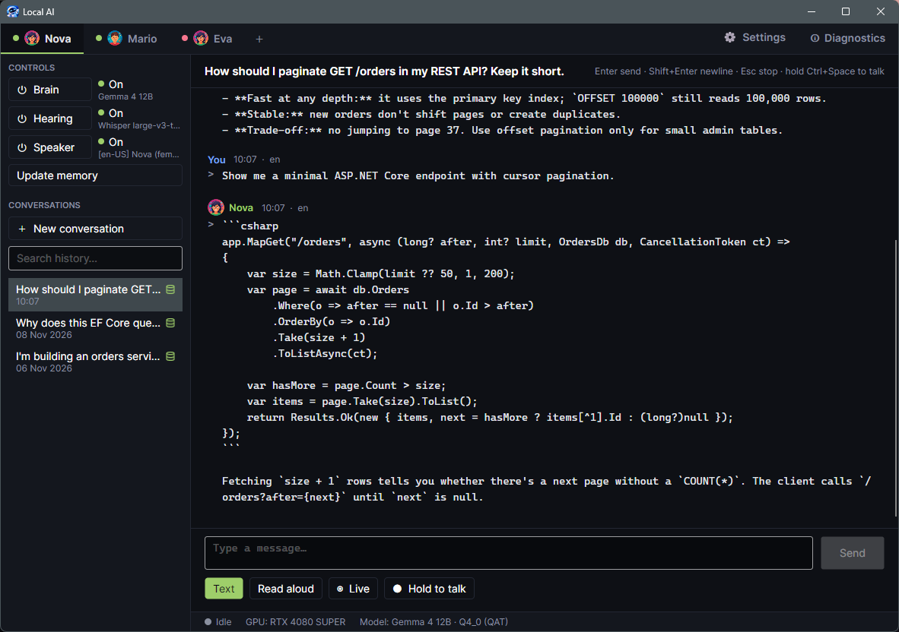
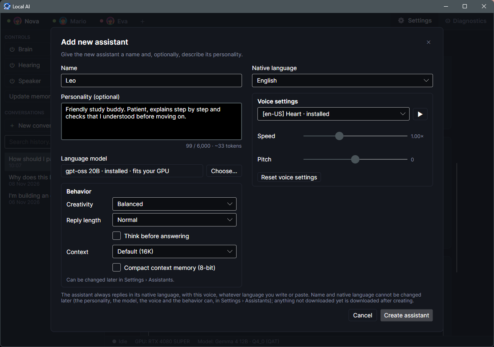
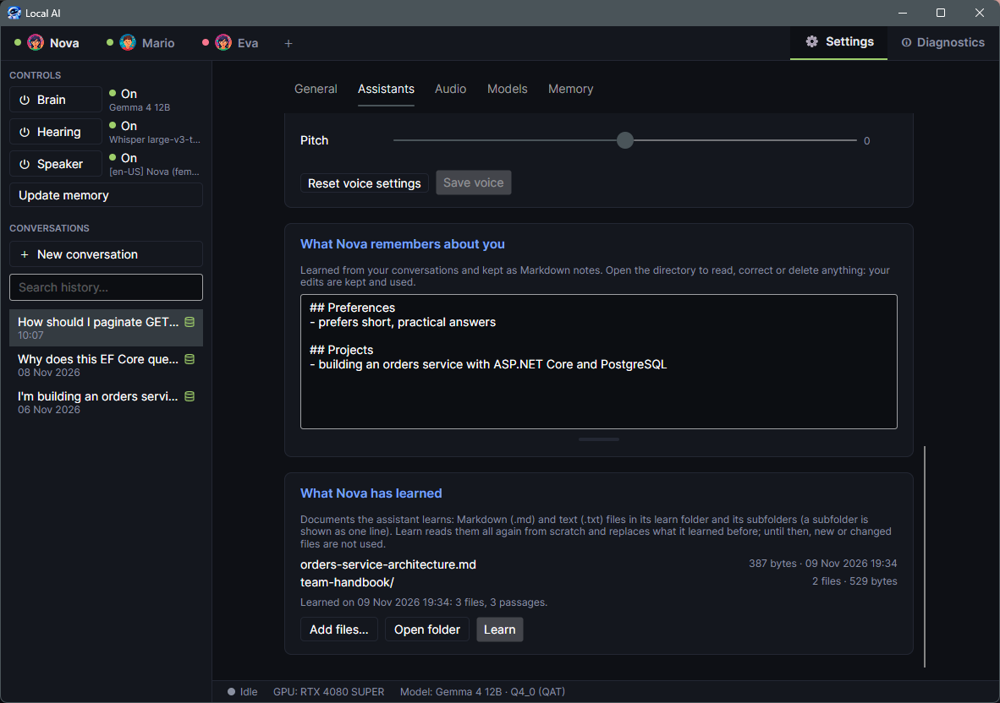
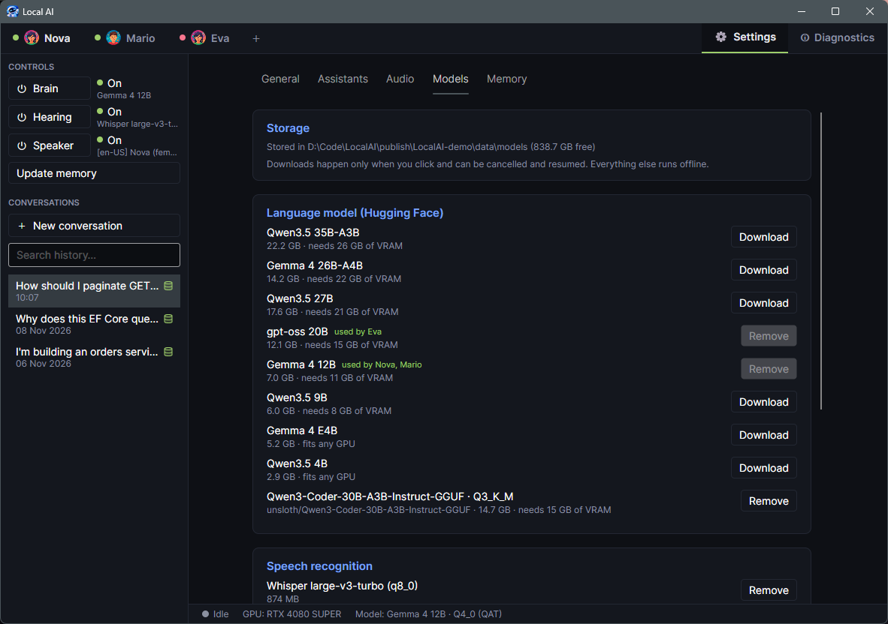
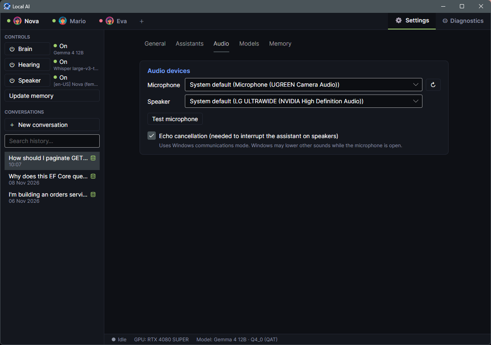

<h1 align="center">Local AI</h1>

<p align="center">
  
</p>

<p align="center">
  <b>Personal AI assistants that run entirely on your Windows PC.</b><br>
  Chat or talk out loud. Conversations, voice and memories never leave your computer.
</p>

<p align="center">
  
  
  
  
</p>

<p align="center">
  
</p>

## Features

- **Your own assistants:** each has a name, personality, native language, language model, voice, conversations and
  memory. One tab per assistant; **＋** adds one.
- **Change them anytime** (Settings › Assistants): the personality, the language model and its context, the voice
  with its speed and pitch, and the behavior (creativity, reply length, thinking).
- **Controls:** **Brain** loads the language model and memory search, **Hearing** the speech recognition, **Speaker**
  the voice. Nothing loads until you turn the Brain on.
- **Any open model:** recommended models for your GPU, or any GGUF model on Hugging Face (`OFFICIAL` marks the
  maker's own). Each quantization says whether it fits your GPU.
- **One language:** an assistant always replies in its native language, whatever you write or paste.
- **Learns your documents:** put `.md`/`.txt` files in its `learn` folder (subfolders too) and click **Learn**.
- **Memory you can read:** Markdown notes, ready for Obsidian. Click **Update memory**, or turn on auto update to
  have it run when idle.
- **Always at hand:** runs in the tray, with a global shortcut per assistant for voice.
- **Offline and portable:** everything stays in the app folder. The Internet is used only to download models.

<table>
  <tr>
    <td width="50%"></td>
    <td width="50%"></td>
  </tr>
  <tr>
    <td align="center">Add an assistant: personality, language, model and voice</td>
    <td align="center">What it remembers about you, as Markdown notes</td>
  </tr>
  <tr>
    <td></td>
    <td></td>
  </tr>
  <tr>
    <td align="center">Models downloaded and managed in the app</td>
    <td align="center">Audio devices: the system default, or one you pick</td>
  </tr>
</table>

## Ways to talk

| Mode | What it does |
|---|---|
| ⌨️ **Text** | You type, the reply appears as text. |
| 🔊 **Read aloud** | You type, the assistant also speaks the reply. |
| 🎙️ **Live** | Hands-free conversation: just talk, and interrupt it anytime by speaking. |

- **Hold to talk** (or **Ctrl+Space**) in Text and Read aloud modes. **Esc** or **Stop** ends a reply.
- **Natural turns in Live:** it waits when you sound unfinished, says *"mm-hmm"* in your pauses and fills slow replies
  with *"let me see..."*. Set these up in Settings › General.
- **Read selection** (off by default): in Live mode, select text in any app while you talk. The text goes with your
  question, e.g. *"why does this fail?"*.

## Memory

Each assistant keeps Markdown notes in its own folder:

```
local-ai/nova/
  nova-identity.md     who the assistant is (edit it to change how it acts)
  nova-profile.md      what it knows about you
  conversations/...    one note per conversation
```

- **Recall (RAG):** before each reply it searches its notes and learned documents, by meaning and by words.
- **Your edits win:** text you change in the notes is never overwritten.
- **Only when you ask:** **Update memory** writes the notes. **Auto update memory** (off by default) does the same after
  10 idle minutes, and stops as soon as you talk.
- **Where:** in the app folder, or in your Obsidian vault (Settings › Memory).

## Getting started

Download `LocalAI-win-x64.zip` from the [latest release](https://github.com/lluancarlo/LocalAI/releases/tag/latest),
unzip it and run `LocalAI\LocalAI.exe`. Create your first assistant; the app downloads the models it needs and resumes
any download that stopped.

Build it yourself (Windows 11, [.NET 10 SDK](https://dotnet.microsoft.com/download), NVIDIA GPU recommended, ~9 GB for
models):

```powershell
git clone https://github.com/lluancarlo/LocalAI.git
cd LocalAI
powershell -ExecutionPolicy Bypass -File scripts\publish.ps1
publish\LocalAI\LocalAI.exe
```

Closing the window keeps the app in the tray; **Exit** in the tray menu quits.

## Privacy

- Conversations, voice and memories never leave your PC.
- Everything the app creates is in `data\` next to the executable. Delete the folder to remove it all. The only
  exception is an Obsidian vault you choose for the notes.
- Logs never record what you say, type or select.
- Windows itself keeps a few records of any program you run, such as tray settings, microphone history and Prefetch.
  They contain only the path and timestamps.

## Built with

| Area | Technologies |
|---|---|
| App | C# / [.NET 10](https://dotnet.microsoft.com/), [Avalonia UI](https://avaloniaui.net/), [CommunityToolkit.Mvvm](https://github.com/CommunityToolkit/dotnet) |
| Language model | [llama.cpp](https://github.com/ggml-org/llama.cpp) (CUDA) with GGUF models from [Hugging Face](https://huggingface.co/) (Gemma 4, Qwen3.5, gpt-oss and more) |
| Memory | Markdown notes, [EmbeddingGemma](https://huggingface.co/ggml-org/embeddinggemma-300M-GGUF) embeddings, [SQLite](https://www.sqlite.org/) FTS5 |
| Speech | [Whisper.net](https://github.com/sandrohanea/whisper.net) (recognition), [sherpa-onnx](https://github.com/k2-fsa/sherpa-onnx) with [Kokoro-82M](https://huggingface.co/hexgrad/Kokoro-82M) (voices) and [Silero VAD](https://github.com/snakers4/silero-vad) |
| Audio and Windows | [NAudio](https://github.com/naudio/NAudio) (WASAPI), Win32 hotkeys, UI Automation, tray icon |
| Infrastructure | Microsoft.Extensions, [Serilog](https://serilog.net/), [xUnit](https://xunit.net/), GitHub Actions |

Licenses of bundled components: [THIRD-PARTY-NOTICES.md](THIRD-PARTY-NOTICES.md).

## License

No license: all rights reserved. The source code is public to read, but you may not modify, copy or distribute it.
Bundled third-party components keep their own licenses.
